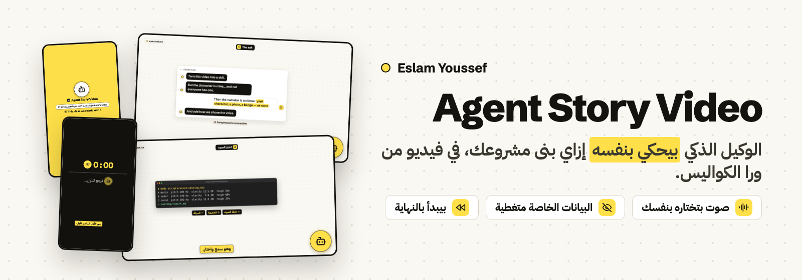
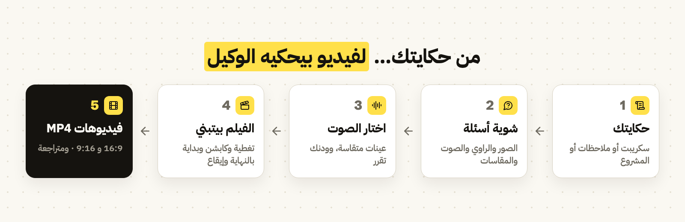
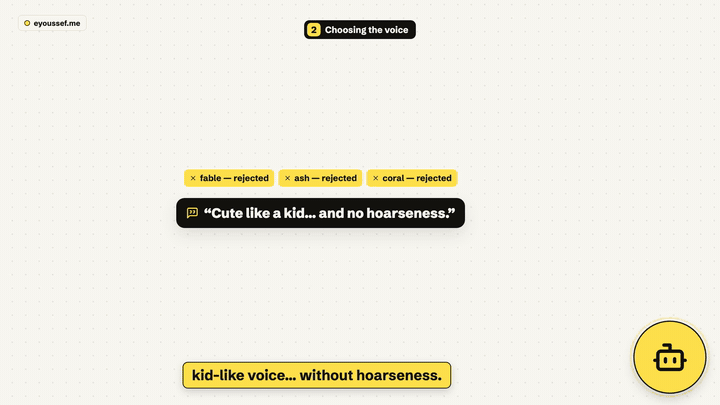
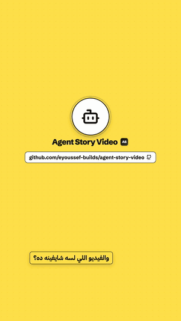
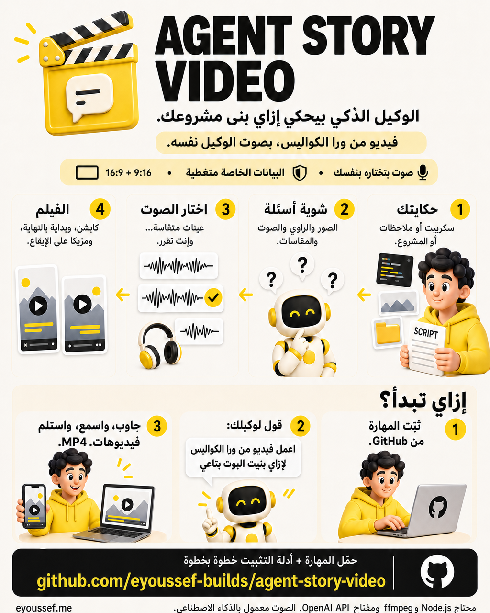
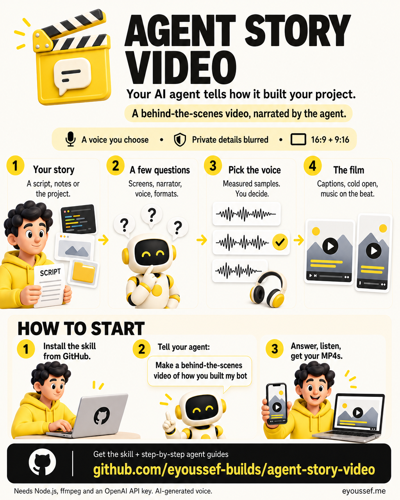

<div dir="rtl">

<p align="center">
  
</p>

<p align="center"><a href="README.md"><b>Read this guide in English</b></a> · <a href="#example">شوف مثال</a> · <a href="#installation">التثبيت</a> · <a href="#first-video">أول فيديو</a> · <a href="#voice">اختيار الصوت</a> · <a href="#questions">أسئلة وأجوبة</a> · <a href="#share">المشاركة</a></p>

<p align="center">
  <a href="LICENSE"></a>
  <a href="docs/agent-installation.ar.md"></a>
  
  
</p>

---

## 👋 إيه هي Agent Story Video؟

بنيت حاجة مع وكيل ذكاء اصطناعي: بوت، أو تطبيق، أو أداة أوتوميشن. الحاجة الجاهزة نص الحكاية بس. الناس كمان عايزة تعرف **حصلت إزاي**: إنت سألت إيه، والوكيل غلط فين، وسألك إيه، واتجربت واتصلحت إزاي. والحكاية دي عشان تتحكي صح محتاجة سكريبت، وصور شاشة، وصوت، وكابشن، ومزيكا، يعني أيام مونتاج.

**Agent Story Video مهارة لوكيل البرمجة بتاعك بتحوّل الحكاية دي لفيديو، والوكيل نفسه هو اللي بيحكيه.**

1. **تديله الحكاية**: السكريبت بتاعك، أو ملاحظاتك والمشروع، وهو يكتب سكريبت توافق عليه.
2. **يسألك شوية أسئلة** الأول: أنهي صور، وعندك شخصية راوي ولا لأ، والصوت يبقى عامل إزاي، وأنهي لغات ومقاسات.
3. **تختار الصوت** من عينات قصيرة. هو بيقيس كل عينة (الطبقة، والوضوح، والبحّة) ويظبطها على حسب رأيك.
4. **يبني الفيلم**: صور شاشة حقيقية والبيانات الخاصة متغطية، والمحادثات وقوايم المهام مرسومة موشن جرافيك، وكابشن مع كل كلمة بتتقال، وبداية بتفتح بالنهاية، ومزيكا مقصوصة على الإيقاع.
5. تستلم **فيديوهات MP4 جاهزة** بمقاس 16:9 و9:16، بالعربي المصري و/أو الإنجليزي.

<p align="center"></p>

المهارة معمولة للناس اللي بتبني حاجات مع وكلاء الذكاء الاصطناعي وعايزة توري **إزاي**، خصوصًا لو جمهورك بيتكلم عربي.

### هتستلم إيه؟

| الجزء | اللي هتشوفه |
| --- | --- |
| 🎬 **الفيديوهات** | `Name-AR-16x9` و`Name-AR-9x16` و`Name-EN-…`، بدقة 1080p و30 إطار في الثانية، وطولها على قد الحكاية (غالبًا من دقيقة ونص لـ4 دقايق). |
| 🧭 **حكاية حقيقية** | الطلب ← أول إجابة من الوكيل (وغالبًا بتكون ناقصة) ← أسئلته ← البناء ← الاختبار والتصليح ← الديمو ← تجربه فين. ولو الحوار متعاد صياغته، بيتكتب ده على الشاشة. |
| 🖼️ **شاشات حقيقية بأمان** | صور شاشتك الحقيقية، متقصوصة ومعمول لها زووم، وأرقام الحسابات والإيميلات والتوكنز وأسامي الناس التانيين **متغطية**. والمحادثات وقوايم المهام والـterminal مرسومين موشن جرافيك نضيف. |
| 🧑‍🎤 **راوي، لو عايز** | شخصيتك المتحركة (من sprite sheet)، أو صورة أو لوجو، أو شارة بسيطة محايدة، أو **من غير راوي على الشاشة خالص**. وبيفضل هادي وعمره ما يشد الانتباه من الحكاية. |
| 🎙️ **صوت إنت اخترته** | أصوات OpenAI، بتتختار من عينات متقاسة. رفع طبقة الصوت بيعمل صوت شخصية كرتونية، والسرعة والتنضيف بيتظبطوا على ودنك. |
| 💬 **كابشن** | مكتوب على الفيديو، ومتظبط على كل كلمة بتتقال، في برواز أصفر. |
| ⏪ **بداية بالنهاية** | الفيلم بيفتح بأقوى جملة في النهاية، وبعدين يرجّع لورا («خلّوني أرجعكم للأول…»)، ويحكي الحكاية من أولها. |
| 🎵 **مزيكا على الإيقاع** | مقطوعة من Pixabay **غير مسجّلة في Content ID**. كل مشهد بيبدأ على ضربة، والديمو بينزل على ذروة المزيكا، والمزيكا بتوطى تحت الصوت. |
| ✅ **مراجعة للنتيجة** | لقطات لكل مشهد، ومراجعة للتغطية، وفحص تلقائي للمقاس والمدة وعلو الصوت (حوالي ‎−16 LUFS‎) والذروات وتوقيت الـdrop، ومراجعة أخيرة على ملفات الـMP4 نفسها. |

---

<a id="example"></a>

## 🎞️ شوف مثال

الفيديو ده عملته المهارة بنفسها، وبيحكي الحكاية الحقيقية لإزاي **المهارة دي** اتعملت، والراوي فيه الشارة البسيطة (من غير شخصية مرسومة)، بالعربي والإنجليزي.

<p align="center">
  
  
</p>

**شوف أو نزّل الأربع فيديوهات التجريبية (بالصوت)** من [آخر إصدار](https://github.com/eyoussef-builds/agent-story-video/releases/latest). الصوت مولّد بالذكاء الاصطناعي (OpenAI، صوت *marin*). المزيكا: ‏"Digital Technology"‏ من AtlasAudio عبر [Pixabay](https://pixabay.com/music/corporate-digital-technology-617560/).

---

<a id="installation"></a>

## 📥 التثبيت خطوة بخطوة

**هتحتاج:**

| إيه | ليه |
| --- | --- |
| وكيل برمجة يقدر **يشغّل أوامر على جهازك** | المهارة بتسطّب حزم وبتعمل رندر للفيديو وبتراجع الملفات. اتجربت على **Claude Code** (تطبيق الديسكتوب) على الماك. |
| **Node.js 18+** و**ffmpeg** | الرندر (Remotion) وشغل الصوت. |
| **مفتاح OpenAI API** | عينات الصوت، والتعليق الصوتي، وتوقيت كلماته. غالبًا كام سنت للجولة بأسعار OpenAI العادية. |
| إنترنت | الخطوط، والبحث عن المزيكا، وطلبات OpenAI. |
| اختياري: **أداة متصفح** في وكيلك | عشان الوكيل يدوّر على المزيكا في Pixabay. من غيرها هيطلب منك تنزّل 2 لـ4 مقطوعات بنفسك. |

### أسهل طريقة: خلّي الوكيل يسطّبها

1. **افتح وكيل البرمجة** في جلسة تقدر تنزّل وتحفظ ملفات.
2. **انسخ الرسالة دي وابعتها:**

<div dir="ltr">

```text
Install agent-story-video from
https://github.com/eyoussef-builds/agent-story-video.
Read the installation guide and inspect the skill first. Install
skills/agent-story-video in this agent's supported personal skill directory.
Preserve any existing customized copy. Then check that Node.js and ffmpeg
are installed. Tell me when it is ready and how to use it.
```

</div>

3. **اقرأ أي طلب إذن للتنزيل أو الحفظ.** الوكيل محتاج إذن عشان يحفظ المهارة.
4. **اتأكد إنها جاهزة.** اسأله: «شايف agent-story-video، وكل اللي محتاجاه متسطّب؟»

🎉 **سطّبتها؟ اعمل [أول فيديو](#first-video).**

### تحب تنسخ المجلد بنفسك؟

1. **[نزّل ملف الـZIP](https://github.com/eyoussef-builds/agent-story-video/archive/refs/heads/main.zip)** (أو ملف المهارة من [آخر إصدار](https://github.com/eyoussef-builds/agent-story-video/releases/latest)).
2. **فك الضغط.** على الماك دبل كليك. على ويندوز كليك يمين ← **Extract All…**.
3. افتح المجلد ← **skills** ← هتلاقي **agent-story-video**.
4. انسخ **المجلد كله** (ومعاه `template` و`references` و`evals` و`agents`) للمكان المكتوب في [دليل وكيلك](docs/agent-installation.ar.md). في Claude Code ده `~/.claude/skills/`.
5. افتح الوكيل تاني أو اعمله reload لو محتاج، واطلب منه يستخدم **agent-story-video**.

الدليل بيغطي **15 وكيل**، بخطوات للماك/لينكس وويندوز. Claude Code على الماك بس هو اللي اتجرب من الأول للآخر، والوكلاء التانيين يقدروا يقروا التعليمات على حسب دعم كل واحد.

---

<a id="first-video"></a>

## 🚀 أول فيديو

### 1. اطلبه

في **Claude Code** ابعت حاجة زي:

<div dir="ltr">

```text
/agent-story-video make a behind-the-scenes video where my agent tells how it built my Telegram
reminder bot. The script and screenshots are in ~/Desktop/bot-story/
```

</div>

أي صياغة تنفع، زي «اعمل فيديو من ورا الكواليس للمشروع ده». مفيش سكريبت؟ قوله، وهو هيكتب واحد من ملاحظاتك ومشروعك وتوافق عليه.

### 2. جاوب على أسئلته

هيسألك مرة واحدة، كل الأسئلة مع بعض، ومع كل سؤال اختيار مقترح:

- يستخدم السكريبت بتاعك زي ما هو، ولا يكتب هو واحد
- صور شاشة حقيقية مع موشن جرافيك، ولا موشن جرافيك بس
- شخصية الراوي بتاعتك، ولا صورة أو لوجو، ولا شارة بسيطة، ولا من غير راوي
- الصوت يبقى عامل إزاي
- أنهي لغات ومقاسات

وكمان هيستأذنك **مرة واحدة** قبل ما يستخدم مفتاح OpenAI API. لو المفتاح متشال في Keychain على الماك، هيظهرلك طلب **Allow**. المفتاح بيروح لأوامر الصوت بس، وعمره ما بيتطبع أو يتحفظ.

### 3. اختار الصوت

هتوصلك 3 أو 4 عينات MP3 قصيرة وجدول صغير بالقياسات. قوله أنهي واحدة أقرب، أو إيه اللي مش مظبوط («سريع شوية»، «فيه بحّة»، «غريب شوية»). هيعدّل ويبعتلك جولة جديدة لحد ما تقول إنه مظبوط. ← [إزاي اختيار الصوت بيتم](#voice)

### 4. سيبه يبني (كام ساعة شغل من الوكيل لفيلم 3 دقايق)

هتشوف تحديث قصير مع كل خطوة: الستوري بورد وتغطية الصور، ومعاينة صامتة، والمزيكا، والتعليق الصوتي والكابشن، والخطة المظبوطة على الإيقاع، والرندر، والمراجعة، والمراجعة الأخيرة.

> 💡 **عمرها ما بتنشر حاجة.** الفيديوهات بتفضل على جهازك، في مجلد المشروع اللي هيقولك عليه.

### 5. اتفرج واسمع وقول رأيك

هتستلم ملفات الـMP4 وملخص قصير: المشاهد، والصوت، والمقطوعة (الاسم، والفنان، ولينك Pixabay)، واللي اتراجع. **اسمع بنفسك لو سمحت**، لأن الوكيل مبيسمعش صوت؛ هو بيقيس علو الصوت ويراجع الكلام بتفريغ مكتوب. وبعدها اطلب أي تعديل بكلام عادي: «الراوي بيتحرك كتير»، «ابدأ بالنهاية»، «خلّي الكابشن أصفر». التعديل وإعادة الرندر بياخدوا دقايق.

> 📣 **لما تنشر:** سياسات OpenAI بتطلب إنك تقول للناس إن الصوت معمول بالذكاء الاصطناعي، فاكتب «تعليق صوتي بالذكاء الاصطناعي» في الكابشن. وذكر المزيكا (الاسم · الفنان · Pixabay) حاجة كويسة.

---

<a id="voice"></a>

## 🎙️ اختيار الصوت

الصوت **هو** الشخصية، عشان كده المهارة عمرها ما بتختاره لوحدها. ولأن الوكيل مبيسمعش، بتجمع بين ودنك والأرقام:

| الخطوة | اللي بيحصل |
| --- | --- |
| **الوصف** | سطر واحد من إجابتك، زي «صوت طفل لطيف ومبسوط، من غير بحّة». |
| **الجولة الأولى** | 3 أو 4 أصوات مختلفة من OpenAI بيقروا سطرين أو تلاتة من سكريبتك **إنت**، بنفس سرعة الفيلم النهائي. |
| **القياس** | لكل عينة: طبقة الصوت (Hz)، وحيويته، و**الوضوح والخشونة** (اللي بتسمعه بحّة أو نفَس)، وسرعة الكلام، وهل كل كلمة اتسمعت. |
| **قرارك** | تسمع وتختار، أو تقول إيه المشكلة. |
| **التظبيط** | كلامك بيتحوّل لتعديلات: «غريب» ← رفع طبقة أقل؛ «فيه بحّة» ← صوت أساسي تاني وتنضيف؛ «سريع» ← أبطأ. والنسخ المعدّلة من تسجيل موجود مش بتتكلف حاجة. |
| **التثبيت** | الإعدادات اللي وافقت عليها بتدخل في التعليق الصوتي بتاع الفيلم. |

<details>
<summary><b>ليه نقيس أصلًا؟</b></summary>

في الفيلم اللي المهارة دي طلعت منه، اترفضت تلات أصوات على طول، وصوت طفل كان «غريب شوية»، واللي بعده كان فيه «بحّة». والقياسات جت مطابقة لرأي صاحب الفيلم: الصوت اللي اتقبل كان أعلى واحد في الوضوح وأقل واحد في الخشونة. القياسات بتساعد الوكيل يفرز ويشرح اقتراحاته، لكن عمرها ما بتغلب ودنك.

</details>

---

## 🎨 خلّيها بتاعتك

| عايز تغيّر… | فين |
| --- | --- |
| الاسم والموقع واللوجو والألوان على الشاشة | `template/src/brand.json` في المهارة المتسطّبة |
| الراوي (شخصية، صورة، شارة، أو من غير) | `src/narrator.json` في مشروع الفيديو (اقرأ `references/narrator.md`) |
| مكان مفتاح الـAPI، ومجلد الشغل، وشخصيتك | ملف خاص اختياري `references/local-profile.md` (متشاركوش أبدًا) |
| الكلام والمشاهد والصور في فيديو | اطلب من الوكيل، أو عدّل `storyboard.json` و`narration.json` و`story/shots.ts` في المشروع ده |

---

## 🔒 الخصوصية في دقيقة

- المستودع ده فيه **تعليمات، وقالب فيديو، وبرامج مساعدة، وحكاية تجريبية** عن عمل المهارة دي. مفيش بيانات خاصة.
- **صور الشاشة هي المكان اللي البيانات بتظهر فيه.** المهارة بتقصّها وبتغطّي أرقام الحسابات والإيميلات والتوكنز واللينكات الخاصة وأسامي الناس التانيين، وتراجع كل تغطية بالحجم الكامل وتاني في الفيديو النهائي. وبرضه اتفرج على الفيديو بنفسك قبل ما تنشره.
- نموذج وكيلك بيقرأ السكريبت والصور. **نص التعليق** بيروح لـOpenAI عشان يتعمل الصوت، و**الصوت** بيرجع لـOpenAI عشان توقيت الكلمات. البحث عن المزيكا بيحصل على Pixabay من متصفح الوكيل، والخطوط من Google Fonts. والرندر بيحصل **على جهازك**.
- شخصية الراوي اللي بتملكها بتفضل في مشروعك. المهارة عمرها ما بتحطها في قوالب مشتركة أو في فيديو حد تاني، وعمرها ما **بتنشر أو ترفع أو تبعت** الفيديوهات.

التفاصيل كاملة: [دليل الخصوصية](docs/privacy.ar.md).

---

<a id="questions"></a>

## ❓ أسئلة وأجوبة

<details>
<summary><b>معنديش ماسكوت أو أفاتار. أقدر أستخدمها؟</b></summary>

أيوه. اختار الشارة البسيطة (أيقونة في دايرة بتنوّر لما الوكيل يتكلم) أو من غير راوي على الشاشة خالص، والصوت والكابشن هيحكوا الحكاية. الفيديو التجريبي مستخدم الشارة.

</details>

<details>
<summary><b>إزاي أستخدم شخصيتي المتحركة؟</b></summary>

ادّي الوكيل sprite sheet: صف لكل وضع (واقف، بيسلّم، بيشتغل…)، والإطارات من الشمال لليمين، وكل الخانات بنفس المقاس، والخلفية شفافة. الإعداد في `narrator.json`. والمحرك بيخلّيها هادية: أغلب الوقت ثابتة، وفيه نطّة واحدة وتسليمة واحدة في الفيلم كله.

</details>

<details>
<summary><b>بتتكلف كام؟</b></summary>

المهارة مجانية (MIT). عينات الصوت والتعليق الصوتي والتفريغ غالبًا بيتكلفوا كام سنت للجولة بأسعار OpenAI العادية. مزيكا Pixabay مجانية تحت رخصة Pixabay. وتكلفة وكيل البرمجة بتاعك زي ما هي. ولو إنت شركة، شوف ملاحظة Remotion تحت.

</details>

<details>
<summary><b>YouTube أو فيسبوك ممكن يعملوا claim على الفيديو؟</b></summary>

المهارة بتختار بس مقطوعات Pixabay **اللي مش متعلّم عليها** «Content ID registered»، ودي اللي غالبًا بتعمل claims تلقائية. ده بيقلل الخطر جدًا لكن مبيضمنش، فاحتفظ بلينك المقطوعة على Pixabay (الوكيل بيديهولك).

</details>

<details>
<summary><b>إيه الفرق بينها وبين Product Showcase Video؟</b></summary>

[Product Showcase Video](https://github.com/eyoussef-builds/product-showcase-video) بتحوّل ريبو على GitHub لفيديو إطلاق من 45 لـ65 ثانية. أما Agent Story Video فبتحكي **إزاي الحاجة اتعملت**: حكاية أطول وصادقة بصوت راوي، بصور شاشة حقيقية وكابشن وبداية بالنهاية، ومبنية على نفس المحرك.

</details>

<details>
<summary><b>أقدر أستخدمها في Codex أو Cursor أو وكيل تاني؟</b></summary>

التعليمات ممكن تتقري في الوكلاء اللي في [دليل التثبيت](docs/agent-installation.ar.md). لازم الوكيل يقدر يشغّل أوامر على جهازك (Node.js وffmpeg ومتصفح خفي للرندر). Claude Code على الماك بس هو اللي اتجرب من الأول للآخر.

</details>

<details>
<summary><b>بتشتغل على ويندوز أو لينكس؟ وبلغات تانية؟</b></summary>

الأدوات (Node.js وRemotion وffmpeg) شغالة على التلاتة، بس المهارة اتجربت على الماك بس. على ويندوز حط المفتاح في متغيّر البيئة `OPENAI_API_KEY`. والمهارة معمولة للإنجليزي والعربي المصري، بما فيها الكتابة من اليمين للشمال. اللغات التانية محتاجة تعديل في دليل الكتابة وتوجيهات الصوت.

</details>

<details>
<summary><b>أقدر أستخدمها في الشغل أو لعملاء؟</b></summary>

المهارة نفسها [MIT](LICENSE): تستخدمها وتعدّلها وتشاركها، حتى تجاريًا، بشرط تحتفظ بالإشعار. القالب بيستخدم **Remotion**، وليه رخصة خاصة: مجاني للأفراد والشركات لحد 3 أشخاص، والشركات الأكبر محتاجة [رخصة شركات من Remotion](https://www.remotion.dev/license). والمزيكا تحت رخصة Pixabay. شوف [إشعارات الأطراف التالتة](THIRD_PARTY_NOTICES.md).

</details>

<details>
<summary><b>إزاي أحدّثها أو أشيلها أو أصلّح ظهورها؟</b></summary>

قارن التنزيل الجديد بالنسخة المتسطّبة، واحتفظ بـ`brand.json` والملف الشخصي بتوعك قبل ما تستبدل. عشان تشيلها، امسح مجلد `agent-story-video` المتسطّب بس. ولو مش ظاهرة، راجع المكان، وتركيبة المجلد كاملة، واسم ملف `SKILL.md`، واعمل reload. شوف [حل المشاكل](docs/agent-installation.ar.md#troubleshooting).

</details>

---

<a id="share"></a>

## 🖼️ شارك المهارة

صورتين إنفوجرافيك بيشرحوا المهارة بتعمل إيه وإزاي تبدأ، ومعاهم لينك GitHub.

[الصورة الإنجليزي](docs/images/infographic-en.png) · [الصورة العربي](docs/images/infographic-ar.png) · [كابشن جاهز بلغتين](docs/share.md)

<p align="center">
  <a href="docs/images/infographic-ar.png"></a>
  <a href="docs/images/infographic-en.png"></a>
</p>

---

## 🛠️ للمطورين

<div dir="ltr">

```text
skills/agent-story-video/
  SKILL.md        The workflow the agent follows
  references/     Story, scenes, screenshots & masks, narrator, voice casting, audio, QA guides
  template/       The Remotion project copied for every film (contains the sample story)
    src/          Scene types, narrator, captions, storyboard.json, narration.json, brand.json
    scripts/      Voice casting, voice-over, captions, planner, music analysis/extension,
                  rewind sound, Pixabay search, stills, render, checks
  evals/          An end-to-end test case
  agents/         Codex metadata
docs/             Installation for 15 agents and privacy guides, in both languages
```

</div>

<details>
<summary><b>شغّل القالب لوحده</b></summary>

**محتاج:** Node.js 18+ وffmpeg. من نسخة من `template/`:

<div dir="ltr">

```sh
npm install
node scripts/plan-timeline.mjs --preview      # a silent plan with estimated timings
node scripts/stills.mjs en-landscape --scenes # contact sheet in out/stills/
npx remotion studio                           # live preview in the browser
node scripts/voice-casting.mjs --measure some-voice.mp3   # pitch, clarity, roughness of any audio
```

</div>

الفيلم الحقيقي محتاج كمان `public/music.mp3` مع `music/analysis.json` (من `scripts/analyze-music.mjs`)، والتعليق الصوتي في `public/vo/` (من `scripts/make-voiceover.mjs`، ومحتاج `OPENAI_API_KEY`). وبعدها `make-captions.mjs` و`plan-timeline.mjs` و`make-rewind.mjs` و`render-all.mjs` و`check-output.mjs`. ومتصفح Remotion الخفي لازم يشتغل برا أي sandbox للأوامر.

</details>

## 🤝 الدعم والتواصل

عندك سؤال أو فكرة؟ [افتح issue](https://github.com/eyoussef-builds/agent-story-video/issues) بالعربي أو الإنجليزي. وللحاجات الخاصة، ابعت إيميل على **[hello@eyoussef.me](mailto:hello@eyoussef.me)**.

**من عمل [إسلام يوسف](https://eyoussef.me) ([eyoussef-builds](https://github.com/eyoussef-builds))** · ✉️ [hello@eyoussef.me](mailto:hello@eyoussef.me) · 🌐 [eyoussef.me](https://eyoussef.me) · [رخصة MIT](LICENSE)

</div>
