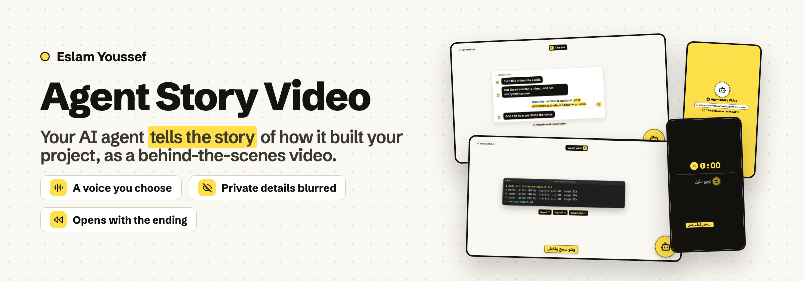
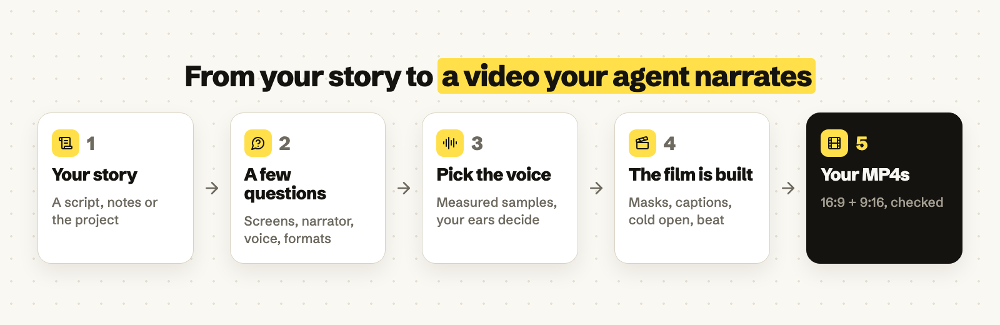

<p align="center">
  
</p>

<p align="center"><a href="README.ar.md"><b>اقرأ هذا الدليل بالعربية</b></a> · <a href="#example">See an example</a> · <a href="#installation">Install</a> · <a href="#first-video">Make your first video</a> · <a href="#voice">Choosing the voice</a> · <a href="#questions">Questions &amp; answers</a> · <a href="#share">Share</a></p>

<p align="center">
  <a href="LICENSE"></a>
  <a href="docs/agent-installation.md"></a>
  
  
</p>

---

## 👋 What is Agent Story Video?

You built something with an AI agent: a bot, an app, an automation. The finished thing is only half the story. People also want the *making-of*: what you asked, where the agent got it wrong, what it asked you, how it was tested and fixed. Telling that story well takes a script, screen captures, voice, captions and music, and that's days of editing.

**Agent Story Video is a skill for your coding agent that turns that story into a narrated video, told by the agent itself.**

1. You **give it the story**: your own script, or your notes and project, and it drafts one for you to approve.
2. It **asks you a few questions** first: which screenshots, whether you have a narrator character, what the voice should sound like, and which languages and formats you want.
3. You **pick the voice** from short samples. It measures each one (pitch, clarity, hoarseness) and adjusts it to your feedback.
4. It **builds the film**. Real screenshots get private details blurred, chats and checklists are drawn as motion graphics, captions follow every spoken word, the ending plays as a cold open, and music is cut on the beat.
5. You get **finished MP4s** in 16:9 and 9:16, in English and/or Egyptian Arabic.

<p align="center"></p>

It's for builders and creators who make things with AI agents and want to show *how*, especially if their audience speaks Arabic.

### What do you get?

| Part | What you see |
| --- | --- |
| 🎬 **Videos** | `Name-AR-16x9`, `Name-AR-9x16`, `Name-EN-…`: 1080p, 30 fps, as long as the story needs (typically 1.5–4 minutes). |
| 🧭 **A true story** | The ask → the agent's first (often incomplete) answer → its questions → the build → testing and fixes → the demo → where to try it. Paraphrased conversations are labelled as such. |
| 🖼️ **Real screens, safely** | Your real screenshots, cropped and zoomed, with account IDs, e-mails, tokens and other people's names **blurred**. Conversations, checklists and terminals are redrawn as clean motion graphics. |
| 🧑‍🎤 **A narrator, if you want one** | Your own animated character (from a sprite sheet), a photo or logo, a neutral badge, or **no on-screen narrator at all**. It stays calm and never steals attention. |
| 🎙️ **A voice you chose** | OpenAI voices, cast from samples with measurements. A pitch lift makes a cartoon-like character voice; speed and clean-up are tuned to your ears. |
| 💬 **Captions** | Burned-in, timed to each spoken word, in a yellow pill. |
| ⏪ **A cold open** | The film opens with its ending's hook, rewinds ("let me take you back…"), then tells the story from the start. |
| 🎵 **Music on the beat** | A Pixabay track that is **not registered with Content ID**. Scenes land on downbeats, the demo lands on the drop, and the music dips under the voice. |
| ✅ **Checked output** | Contact sheets, mask checks, and an automatic check of size, length, loudness (around −16 LUFS), peaks and drop timing, plus a final review of the actual MP4s. |

---

<a id="example"></a>

## 🎞️ See an example

This sample was made by the skill itself. It tells the true story of how **this skill** was made, narrated by the neutral badge (no character art), in English and Arabic.

<p align="center">
  
  
</p>

**Watch or download all four sample videos (with sound)** from the [latest release](https://github.com/eyoussef-builds/agent-story-video/releases/latest). The voice is AI-generated (OpenAI, *marin*). Music: "Digital Technology" by AtlasAudio, via [Pixabay](https://pixabay.com/music/corporate-digital-technology-617560/).

---

<a id="installation"></a>

## 📥 Install it, step by step

**You need:**

| What | Why |
| --- | --- |
| A coding agent that can **run commands on your computer** | The skill installs packages, renders video and checks the files. Tested in **Claude Code** (desktop app) on macOS. |
| **Node.js 18+** and **ffmpeg** | Rendering (Remotion) and audio work. |
| An **OpenAI API key** | Voice samples, the voice-over and its word timing. Usually a few US cents per round at OpenAI's normal prices. |
| Internet access | Fonts, the music search and the OpenAI calls. |
| Optional: a **browser tool** in your agent | Lets the agent search Pixabay for music. Without it, the agent asks you to download 2–4 tracks yourself. |

### The easiest way: let your assistant install it

1. **Open your coding assistant** in a session that can download and save files.
2. **Copy and send this message:**

   ```text
   Install agent-story-video from
   https://github.com/eyoussef-builds/agent-story-video.
   Read the installation guide and inspect the skill first. Install
   skills/agent-story-video in this agent's supported personal skill directory.
   Preserve any existing customized copy. Then check that Node.js and ffmpeg
   are installed. Tell me when it is ready and how to use it.
   ```

3. **Read any download or file-write permission request.** The assistant needs permission to save the skill.
4. **Check that it's ready.** Ask: "Can you see agent-story-video, and is everything it needs installed?"

🎉 **Installed? Now make [your first video](#first-video).**

### Prefer to copy the folder yourself?

1. **[Download the ZIP](https://github.com/eyoussef-builds/agent-story-video/archive/refs/heads/main.zip)** (or the skill ZIP from the [latest release](https://github.com/eyoussef-builds/agent-story-video/releases/latest)).
2. **Unzip it.** On Mac, double-click it. On Windows, right-click → **Extract All…**.
3. Open the extracted folder → **skills** → find **agent-story-video**.
4. Copy that **whole folder** (including `template`, `references`, `evals` and `agents`) to the location in [your agent's guide](docs/agent-installation.md). In Claude Code that's `~/.claude/skills/`.
5. Reopen or reload the agent if needed, then ask it to use **agent-story-video**.

The guide covers **15 agents**, with macOS/Linux and Windows instructions. Only Claude Code on macOS has been tested end-to-end. Other agents can load the instructions according to their own support.

---

<a id="first-video"></a>

## 🚀 Your first video

### 1. Ask for it

In **Claude Code**, send something like:

```text
/agent-story-video make a behind-the-scenes video where my agent tells how it built my Telegram
reminder bot. The script and screenshots are in ~/Desktop/bot-story/
```

Any wording works, for example "make a making-of video for this project", or in Arabic «اعمل فيديو من ورا الكواليس للمشروع ده». No script? Say so, and it will draft one from your notes and project for you to approve.

### 2. Answer its questions

It asks once, in one batch, with a recommended option for each:

- Use your script as written, or let it draft one
- Real screenshots plus motion graphics, or motion graphics only
- Your own narrator character, a photo/logo, a neutral badge, or no narrator
- What the voice should sound like
- Which languages and formats

It also asks **once** before using your OpenAI API key. If the key is in the macOS Keychain, macOS shows an **Allow** prompt. The key goes only into the voice commands; it's never printed or saved.

### 3. Pick the voice

You get 3–4 short MP3 samples and a small table of measurements. Tell it which one is closest, or what's off ("too fast", "a bit hoarse", "sounds weird"). It adjusts and sends a new round until you say it's right. → [How the casting works](#voice)

### 4. Let it build (a few hours of agent work for a 3-minute film)

You'll see one short update per step: storyboard and screenshot masks, a silent preview, music, voice-over and captions, the beat-synced plan, rendering, checks and the final review.

> 💡 **It never posts anything.** The videos stay on your computer, in the project folder it tells you about.

### 5. Watch, listen and give feedback

You get the MP4s and a short summary: the scenes, the voice, the track (title, artist, Pixabay link) and what was checked. **Please listen yourself**, because the agent can't hear audio; it measures loudness and checks the narration with a transcript. Then ask for changes in plain words: "the narrator moves too much", "start with the ending", "make the captions yellow". A change and a re-render take minutes.

> 📣 **When you post:** OpenAI's policies require telling viewers the voice is AI-generated. Add "AI voice-over" to your caption. Crediting the music (title · artist · Pixabay) is good practice.

---

<a id="voice"></a>

## 🎙️ Choosing the voice

The voice *is* the character, so the skill never just picks one. Since the agent can't listen, it pairs your ears with numbers:

| Step | What happens |
| --- | --- |
| **Brief** | One line from your answer, e.g. "a cute, cheerful kid-like voice, no hoarseness". |
| **Round 1** | 3–4 different OpenAI voices read 2–3 lines of *your* script, sped up like the final film. |
| **Measure** | For each sample: pitch (Hz), how lively it is, **clarity and roughness** (what you hear as hoarse or breathy), speaking speed, and whether every word was heard. |
| **Your call** | You listen and pick, or say what's wrong. |
| **Adjust** | Your words become changes: "weird" → a smaller pitch lift; "hoarse" → another base voice plus clean-up; "too fast" → slower. Variants of a take you already have cost nothing. |
| **Lock** | The accepted settings go into the film's voice-over. |

<details>
<summary><b>Why measure at all?</b></summary>

In the film this skill grew from, three voices were rejected outright, a kid-like one was "a bit weird", and the next ones had "hoarseness". The measurements matched those judgments: the accepted voice had the highest clarity and the fewest rough frames. They help the agent pre-screen and explain its suggestions. They never overrule your ears.

</details>

---

## 🎨 Make it yours

| Want to change… | Where |
| --- | --- |
| Name, website, logo and colours on screen | `template/src/brand.json` in your installed skill |
| Your narrator (character, photo, badge or none) | `src/narrator.json` in a video project (see `references/narrator.md`) |
| Where your API key is stored, your workspace, your own character | an optional private `references/local-profile.md` (never share it) |
| The wording, scenes and screenshots of a video | ask the agent, or edit `storyboard.json`, `narration.json` and `story/shots.ts` in that project |

---

## 🔒 Privacy in one minute

- This repository contains **instructions, a video template, helper scripts and a sample story** about making this skill. No private data.
- **Screenshots are where leaks happen.** The skill crops them and blurs IDs, e-mails, tokens, private URLs and other people's names, then checks every mask at full size and again in the final video. Still look at your video before you post it.
- Your agent's model reads your script and screenshots. The **narration text** goes to OpenAI to make the voice, and the **voice audio** goes back to OpenAI for word timing. The music search runs on Pixabay in the agent's browser, and fonts come from Google Fonts. Rendering happens **on your computer**.
- A narrator character you own stays in your project. The skill never puts it into shared templates or anyone else's video. It **never posts, uploads or sends** the videos.

Full details: [Privacy guide](docs/privacy.md).

---

<a id="questions"></a>

## ❓ Questions & answers

<details>
<summary><b>I don't have a mascot or avatar. Can I still use it?</b></summary>

Yes. Choose the neutral badge (an icon in a circle that lights up when the agent speaks) or no on-screen narrator at all, and the voice and captions carry the story. The sample video uses the badge.

</details>

<details>
<summary><b>How do I use my own animated character?</b></summary>

Give the agent a sprite sheet: one row per pose (idle, waving, working…), frames left to right, all cells the same size, on a transparent background. It's configured in `narrator.json`. The engine keeps it calm: it mostly holds a still pose, with one jump and one wave per film.

</details>

<details>
<summary><b>How much does it cost?</b></summary>

The skill is free (MIT). Voice samples, the voice-over and transcription usually cost a few US cents per round at OpenAI's normal API prices. Pixabay music is free under the Pixabay Content License. Your coding agent's own plan or usage costs apply as usual. See the Remotion note below if you're a company.

</details>

<details>
<summary><b>Will YouTube or Facebook put a copyright claim on my video?</b></summary>

The skill only picks Pixabay tracks that are **not** marked "Content ID registered", which is what usually triggers automatic claims. That greatly reduces the risk but can't guarantee it, so keep the track's Pixabay link (the agent gives it to you).

</details>

<details>
<summary><b>How is this different from Product Showcase Video?</b></summary>

[Product Showcase Video](https://github.com/eyoussef-builds/product-showcase-video) turns a GitHub repo into a 45–65 second launch promo. Agent Story Video tells the *making-of*: a longer, honest, narrated story with real screenshots, captions and a cold open. It's built on the same engine.

</details>

<details>
<summary><b>Can I use it in Codex, Cursor or another agent?</b></summary>

The instructions can be loaded in the agents covered by the [installation guide](docs/agent-installation.md). The agent must be able to run commands on your computer (Node.js, ffmpeg, a headless browser for rendering). Only Claude Code on macOS has been tested end-to-end.

</details>

<details>
<summary><b>Does it work on Windows or Linux? In other languages?</b></summary>

The tools (Node.js, Remotion, ffmpeg) run on all three systems; it has only been tested on macOS. On Windows, put your key in the `OPENAI_API_KEY` environment variable. It's designed for English and Egyptian Arabic, including right-to-left layouts. Other languages would need changes to the writing guide and voice directions.

</details>

<details>
<summary><b>Can I use it for work or client projects?</b></summary>

The skill itself is [MIT](LICENSE): use, change and share it, including commercially, keeping the notice. The template uses **Remotion**, which has its own license. It's free for individuals and companies of up to 3 people; larger companies need a [Remotion company license](https://www.remotion.dev/license). Music follows the Pixabay Content License. See [third-party notices](THIRD_PARTY_NOTICES.md).

</details>

<details>
<summary><b>How do I update, uninstall or fix discovery?</b></summary>

Compare a new download with your installed copy, and keep your own `brand.json` and local profile before replacing it. To uninstall, remove only the installed `agent-story-video` folder. If it doesn't appear, check the directory, the full folder structure and the `SKILL.md` filename, then reload. See [troubleshooting](docs/agent-installation.md#troubleshooting).

</details>

---

<a id="share"></a>

## 🖼️ Share this skill

Two infographics explain what the skill does and how to start, with its GitHub link included.

[English image](docs/images/infographic-en.png) · [Arabic image](docs/images/infographic-ar.png) · [Copyable bilingual captions](docs/share.md)

<p align="center">
  <a href="docs/images/infographic-en.png"></a>
  <a href="docs/images/infographic-ar.png"></a>
</p>

---

## 🛠️ For developers

```text
skills/agent-story-video/
  SKILL.md        The workflow the agent follows
  references/     Story, scenes, screenshots & masks, narrator, voice casting, audio, QA guides
  template/       The Remotion project copied for every film (contains the sample story)
    src/          Scene types, narrator, captions, storyboard.json, narration.json, brand.json
    scripts/      Voice casting, voice-over, captions, planner, music analysis/extension,
                  rewind sound, Pixabay search, stills, render, checks
  evals/          An end-to-end test case
  agents/         Codex metadata
docs/             Installation for 15 agents and privacy guides, in both languages
```

<details>
<summary><b>Run the template on its own</b></summary>

**Needs:** Node.js 18+ and ffmpeg. From a copy of `template/`:

```sh
npm install
node scripts/plan-timeline.mjs --preview      # a silent plan with estimated timings
node scripts/stills.mjs en-landscape --scenes # contact sheet in out/stills/
npx remotion studio                           # live preview in the browser
node scripts/voice-casting.mjs --measure some-voice.mp3   # pitch, clarity, roughness of any audio
```

A real film also needs `public/music.mp3` with `music/analysis.json` (from `scripts/analyze-music.mjs`) and the voice-over in `public/vo/` (from `scripts/make-voiceover.mjs`, which needs `OPENAI_API_KEY`). Then run `make-captions.mjs`, `plan-timeline.mjs`, `make-rewind.mjs`, `render-all.mjs` and `check-output.mjs`. Remotion's headless Chrome must run outside any command sandbox.

</details>

## 🤝 Support & contact

Questions or ideas? [Open an issue](https://github.com/eyoussef-builds/agent-story-video/issues) in English or Arabic. For private matters, email **[hello@eyoussef.me](mailto:hello@eyoussef.me)**.

**Created by [Eslam Youssef](https://eyoussef.me) ([eyoussef-builds](https://github.com/eyoussef-builds))** · ✉️ [hello@eyoussef.me](mailto:hello@eyoussef.me) · 🌐 [eyoussef.me](https://eyoussef.me) · [MIT license](LICENSE)
